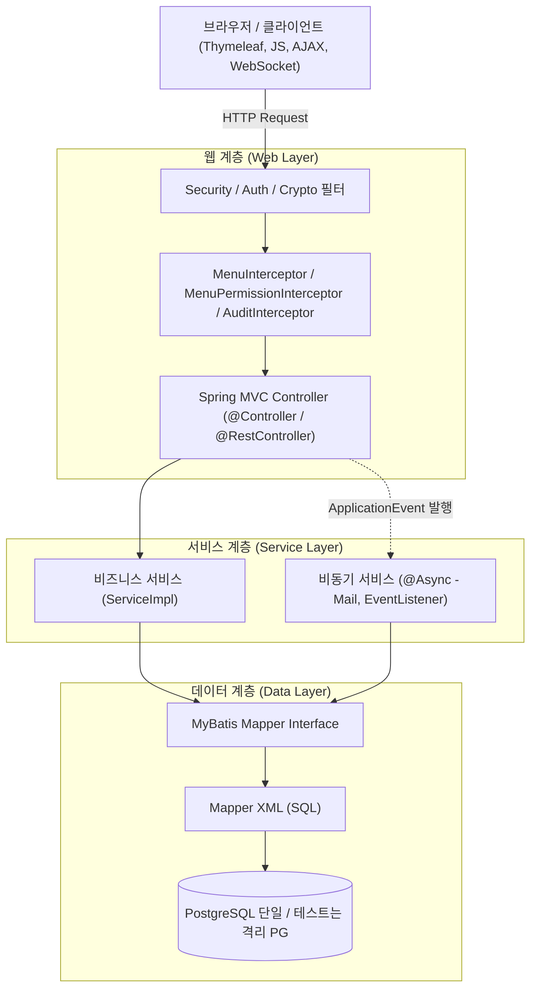

# 프로젝트 개요 및 아키텍처 (Arkive 기록)

> **Arkive 기록 · 대상에 복사 금지.** 대상 지식은 [빈 양식](../portable/project-template-pack.md)을 쓴다.

<!--
문서 상태: 부분 미완성
미완성 항목: 운영 조직·기능 소유권, 운영 프로파일·DB·배포 토폴로지, 보안 정책 승인, 외부 계약, Health·장애 대응·Canary 지원 여부.
필요한 근거/확인자: 업무·보안·운영 담당자, 환경별 설정, 운영 아키텍처 문서, 공식 연계 명세.
완성 방법: 아래 미확인 사항을 담당자 근거로 보강하고 실제 비밀값은 기록하지 않는다.
완료 기준: 운영 구성·소유 역할·외부 계약이 근거와 함께 확인되거나 미확인 항목의 담당자와 후속 확인 경로가 지정되어 있다.
-->

Arkive는 기능 이식용 아카이브/레퍼런스 프로젝트다. 아래는 저장소 코드와 설정에서 확인한 로컬 구성 및 아키텍처이며, 승인된 운영 사양이 아니다.
시스템 개요·실행 설정·아키텍처·공유 지점·오류 체계를 다룬다.

---

## 1. 프로젝트 개요 및 기술 스택

### 확인된 기술 및 실행 구성

| 구분 | 확인된 내용 | 근거 |
| --- | --- | --- |
| 빌드 | Maven, artifact `Arkive:Arkive:1.0.0` | `pom.xml` |
| Java / 프레임워크 | Java 17, eGovFrame Boot parent 5.0.0, Spring Boot 의존성 사용 | `pom.xml` |
| 웹 화면 | Thymeleaf, 템플릿은 `src/main/resources/templates/thymeleaf/` | `pom.xml`, `application.properties` |
| 데이터 접근 | MyBatis, Java Config, Mapper/XML, Boot JDBC 자동 구성의 HikariCP 연결 풀 | `egovframework.example.config.EgovConfigMapper`, `pom.xml`, `application.properties` |
| 기본 포트 | 8080 | `application.properties` |
| 현재 설정 DB | PostgreSQL 단일 구성, 기본 접속 대상 Supabase. 테스트는 로컬 embedded PostgreSQL 17.12·자동 선택 포트 | `application.properties`, `pom.xml`, `src/test/java/arkive/support/PostgresTestDatabaseInitializer.java` |
| DB 초기화 | 새 대상 DB에만 수동 schema→seed, 테스트는 격리 DB에 초기화기가 적용 | `src/main/resources/db/postgres/schema.sql`·`seed.sql`, 테스트 초기화기; 상세는 [검증 및 변경 로그](verification-log.md#4-db-마이그레이션-현황-및-개발자-사용법) |
| 모니터링 | Actuator `health,info,metrics`, `health.show-details=always`; 메일 헬스 기본 비활성 | `application.properties`; 운영 공개 범위 미확인 |
| 운영 배포 / 실서비스 DB | 미확인. 로컬 설정으로 운영 구성을 추정하지 않는다. | 운영 담당자 확인 필요 |

### 실행 전 확인할 환경 설정

근거는 `src/main/resources/application.properties`다. DB는 사용자 요청에 따라 로컬 properties 직접 입력값을 보존한다. 공유/배포 시 실제 자격증명은 대상의 비밀관리 수단으로 분리하며 문서·로그·이식 파일에 복사하지 않는다. 아래 기본값만으로 실연동·운영 안전성을 보장하지 않는다.

| 기능 | 키 / 기본값 | 확인할 것 |
| --- | --- | --- |
| 메일 | `MAIL_ENABLED=false`, `MAIL_FROM` 빈 값, `MAIL_HOST`·`MAIL_PORT`·인증/TLS·base URL | 발신자와 SMTP 설정. 테스트는 `arkive.mail.enabled=false`로 실제 연결하지 않음 |
| 메일 헬스 | `MAIL_HEALTH_ENABLED=false` | SMTP 사용 환경에서 필요할 때 활성화 |
| SMS / SSO | `ARKIVE_SMS_ENABLED=false`, `SSO_ENABLED=false` | 제공자 계약·발신번호·콜백과 대상 정책 |
| 동영상 / 지도 | `FFMPEG_ENABLED=false`, `KAKAO_MAP_KEY` 빈 값 | FFmpeg 설치·VOD 경로, 카카오 허용 도메인 |
| 웹분석 / 검색 | `ARKIVE_ANALYTICS_ENABLED=false`, `ARKIVE_SEARCH_ES_ENABLED=false` | GA4·Clarity ID와 동의, ES 인프라·동기화 |
| 내부 API | `ARKIVE_INTERNAL_API_TOKEN` 빈 값 | 미설정 시 503; 토큰 발급·회전·소비자 계약 |
| 필드 암호화 | `ARKIVE_FIELD_KEY` 빈 값 | TOTP·연락처·사용자 휴대전화 저장이 거부됨. 키 분실 시 암호문 복구 불가 |
| SSE | `layout.html`의 `ARKIVE_SSE_ENABLED=false` | 환경변수가 아닌 화면 설정; 활성화·화면별 옵션은 [기능 카탈로그](feature-catalog.md#3-알림-설정과-실패-처리-sse-mail-sms) |

- **기본 실행:** Java 17·Maven을 준비하고 `src/main/resources/application.properties`의 `spring.datasource.driver-class-name/url/username/password`를 직접 수정한 뒤 `mvn spring-boot:run`으로 PostgreSQL에 연결한다. Boot가 HikariDataSource를 구성한다. 풀은 `spring.datasource.hikari.*`(10/2/10000/3000/600000/1800000), 시간대는 `connection-init-sql=SET TIME ZONE 'Asia/Seoul'`이다.
- **로컬 설정 주의:** 현재 properties에는 실제 비밀번호가 있으므로 파일과 이를 포함한 JAR를 공유·커밋하지 않는다. 배포/공유 시에는 비밀번호를 제거하고 대상의 비밀관리 수단을 사용한다.
- **파일 저장소:** `data/vod/`는 `arkive.vod.path=${VOD_PATH:./data/vod/}`의 동영상 저장 기본 경로다. `FfmpegVideoEncodingService`가 업로드 시 디렉터리를 생성하며 저장소 내용은 `.gitignore`로 제외한다.
- **예약 작업·백업:** `QuartzConfig`는 매일 03시 `TempFileCleanupJob`을 예약하며 ApplicationContext 전달 customizer를 사용한다. PostgreSQL 자동 백업·복원은 미구현이며 `pg_dump` 등 별도 준비가 필요하다.
- **검증 안전:** `verify.cmd`는 `clean verify`이므로 IDE와 같은 `target/classes`를 사용하는 빌드는 시점을 조율한다. 현재 구성의 격리 PostgreSQL 자동 검증과 GUI 잔여 항목은 [최신 정리 기록](verification-log.md#221-2026-11-22-postgresql-단일-dbboot-자동-구성-정리)을 따른다.

---

## 2. 애플리케이션 아키텍처 및 계층 구조

### 전체 계층 구조



### 기본 호출 흐름

```text
Thymeleaf + JS → Controller → Service/Impl → Mapper 인터페이스 → Mapper XML → DB
예: arkive.admin.system.web.SystemController → SystemService/SystemServiceImpl → SystemMapper → System_SQL.xml
```

| 계층/구성 | 위치·확인된 방식 |
| --- | --- |
| 진입점 | `egovframework.example.EgovBootApplication` (`src/main/java/egovframework/example/EgovBootApplication.java`) |
| 패키지 체계 | 업무 `arkive.*`, 샘플·설정 `egovframework.example.*`, 공통 eGovFrame `egovframework.com.*` |
| 화면·정적자원 | `src/main/resources/templates/thymeleaf/`, 공통 조각 `layout/`·`comm/`, 정적 파일 `static/`; `th:replace`·jQuery `$.ajax` |
| Mapper XML | `src/main/resources/egovframework/sqlmap/example/mappers/`; 인터페이스·namespace·SQL ID·입출력 타입 대조 |
| 공통 파일 | `arkive.admin.comm`의 Controller·Service·Mapper·업로드/다운로드 유틸리티 |
| Java Config | `egovframework.example.config`의 DB·Mapper·트랜잭션·웹·비동기 설정 |
| 검증·로깅 | Controller `@Valid`·`BindingResult`, Lombok `@Slf4j` 및 SLF4J `LoggerFactory` 혼재 |

---

## 3. 인증·권한 및 공통 처리

| 영역 | 호출 흐름 및 경계 |
| --- | --- |
| 세션 및 중복로그인 | `LoginController`·`OauthController` → `LoginSessionRegistry`: 사용자별 최신 세션 1개 유지, 새 로그인 시 이전 세션 만료. `EgovConfigWeb`의 `HttpSessionListener`가 만료 매핑 제거. 단일 인스턴스 메모리 기준 |
| 메뉴 권한 체계 | `APP_USER_ROLE` → `APP_ROLE_MENU` → `PermissionServiceImpl`의 메뉴별 OR 집계 → `MenuPermissionInterceptor`의 READ/WRITE 검사. `MenuInterceptor`는 동일 READ 권한으로 사이드바 필터링. `ADMIN_YN='Y'`는 슈퍼관리자로 우회하며 `/system`·`/auth`는 `AuthInterceptor`의 관리자 전용 정책 유지 |
| 사이트맵·공통 기능 | `SitemapController`(`/sitemap`)는 `MenuInterceptor`의 `menuList`를 재사용하며 별도 메뉴 권한 매핑 없이 로그인 검사만 적용. 댓글·쪽지·다운로드·SSE 구독은 메뉴 권한과 분리된 로그인 사용자 공통 기능 |
| TOTP 및 약관 동의 | `LoginController`의 대기 세션 → `/login/totpVerify.json` 코드·복구코드 확인. `TermsInterceptor` → `/login/termsAgree` 유도 → `USER_TERMS_CONSENT` 동의 이력 기록 |
| SSO 연계 | `SsoController`(`/sso`)의 authorization code·세션 state 비교·토큰 교환·사용자 정보 조회 → `OAUTH_LINK`(`PROVIDER='sso'`) 연계 확인 → `LoginSessionService`·TOTP 단계 진행. 자동 가입 기본 비활성 |
| 비밀번호 재설정 | `LoginController` → `AuthServiceImpl.issuePasswordResetToken` → `PASSWORD_RESET_TOKEN` 해시 저장 → `MailAsyncService` 링크 메일 발송. 재설정 성공 시 기존 세션 만료 |
| 감사 및 개인정보 보호 | `AuditInterceptor` → `AuditEvent` → `AuditLogEventListener` → `AuditLogService`/`AUDIT_LOG`. `/system/auditLogList` 조회·엑셀, `AuditRetentionJob` 보관주기 삭제(기본 0=비활성). `MaskingInterceptor`는 `List<EgovMap>` 마스킹, `PiiFieldService`·`FieldCryptoService`는 연락처 AES-GCM(`enc:v1:`) 처리. `APP_USER.EMAIL`은 조회용 평문 유지 |

---

## 4. 비동기 및 예약 작업

| 작업 | 확인된 호출 흐름 |
| --- | --- |
| 게시글 알림 | `BoardController` → `BoardNotificationEvent` → `BoardNotificationEventListener` → SSE·메일·SMS 채널 격리 발송. 구독·수신 동의·선점·실패 규칙은 [기능 카탈로그](feature-catalog.md#3-알림-설정과-실패-처리-sse-mail-sms) 참조 |
| 비동기 메일 | 회원가입·OAuth 가입·관리자 등록·비밀번호 찾기 → `MailAsyncService` → `@Async("mailTaskExecutor")` → `MailServiceImpl` → `JavaMailSender`. Executor는 `EgovConfigAsync`, 기본 비활성 |
| 임시파일 정리 / DB 백업 | `QuartzConfig` → 매일 03시 `TempFileCleanupJob`. DB 자동 백업은 미구현. [보존·복구 주의](verification-log.md#44-보존복구-주의) 참조 |
| 일일 집계 배치 | `BatchConfig`의 `@EnableBatchProcessing`·`DefaultBatchConfiguration` (`ResourcelessJobRepository`·`txManager` 사용). `dailyStatsJob` → `dailyStatsStep` → `DailyStatsTasklet` → `DailyStatsAggregator` → `BatchMapper` → `STAT_DAILY`. 수동 실행만 지원하며 재집계 시 기존 집계 삭제 후 재삽입(멱등) |

---

## 5. 확인된 공통 공유 지점

아래 컴포넌트는 다수의 업무 기능에서 공통으로 의존하므로 변경 시 영향도를 필히 점검한다.

| 공유 지점 | 확인된 소비/영향 경로 | 변경 시 점검 사항 |
| --- | --- | --- |
| 시스템 메뉴 Mapper/SQL | `SystemController` → `SystemService` → `SystemMapper` → `System_SQL.xml` | 메뉴 화면·AJAX 호출, 메뉴 초기 데이터 및 테이블 구조 |
| 파일 공통 처리 | `FileController` → `FileService` / 파일 유틸 → `File_SQL.xml` 및 파일 시스템 | 업로드 방식(일반/TUS/드롭존), 다운로드·삭제 호출처, 저장 경로, 파일 접근 권한 |
| 공통 화면 조각/정적 자원 | Thymeleaf `layout/`, `comm/`, `static/` | 레이아웃을 include하는 전체 화면 렌더링 및 UI 반응형 깨짐 여부 |
| DB 접속/초기화/예약 작업 | Boot JDBC 자동 구성, `application.properties`, `db/postgres/schema.sql`·`seed.sql`, `QuartzConfig`, 테스트 초기화기 | 앱 자동 초기화 없음, 새 DB 수동 적용·기존 DB 별도 마이그레이션, 테스트 격리, 임시파일 정리 |
| 메뉴 시드·사이드바 | `db/postgres/seed.sql` → `MENU`·`APP_ROLE`·`APP_USER_ROLE`·`APP_ROLE_MENU`, `MenuInterceptor` | 메뉴 ID·상위 관계·순서·역할 권한 유지, 새 메뉴 추가 시 초기값 반영 |
| 메뉴 권한 검사 | `PermissionService`, `MenuPermissionInterceptor`, `MenuInterceptor`, `RoleManageController` | 컨트롤러 URL→메뉴 ID 매핑, READ/WRITE 판정, 관리자 우회, 사이드바 노출 |
| 로그인 세션·역할 | `LoginController`, `OauthController`, `LoginSessionRegistry`, `AuthServiceImpl`, `PermissionService` | 로그인·로그아웃·세션 만료, 중복 로그인 제어, 사용자 삭제 시 역할 정리 |
| 메일 발송 | `MailAsyncService` → `MailServiceImpl` → `JavaMailSender`, `EgovConfigAsync` | 회원가입·OAuth·비밀번호 찾기·게시판 알림 호출처, SMTP 설정 및 수신 동의 필터 |
| 비밀번호 재설정 토큰 | `LoginController`, `AuthServiceImpl`, `AuthMapper`, `PASSWORD_RESET_TOKEN` | 로그인 화면, 메일 링크, 기존 세션 무효화, 30분 만료·1회 사용 보장 |
| 공통 예외·헬스 | `EgovConfigWeb`(`SimpleMappingExceptionResolver`), Actuator 설정 | 미매핑 URL·정적 리소스 404, 서버 오류 500, 모니터링 헬스 상태 |

---

## 6. 오류 처리 및 응답 규약

> 중앙 오류 코드 레지스트리 및 `@ControllerAdvice` 전역 처리는 코드에 선언되지 않았으며, 현행 코드 기반의 동작 규약이다.

### 예외 해석 및 화면 응답
- `SimpleMappingExceptionResolver`(`EgovConfigWeb.java`):
  - `NoResourceFoundException`, `NoHandlerFoundException` → `error/error` (404)
  - 기타 모든 `Throwable` → `sample/egovSampleError` (500)
- 미매핑 `.json` 요청도 현재는 HTML 404 뷰를 반환한다.

### JSON 응답 규약 (2종 혼재)
1. **신규 규약:** `{"success": true/false, "message": "..."}`
   - 사용처: `UserManageController`, `OauthController`, `BoardController`(댓글), `MessageController`, `user/qna·poll·counsel`, `LeaveController`, `MeetingController`, `ApprovalController` 등 대다수
2. **레거시 규약:** `{"result": "success"/"fail", "message": "..."}`
   - 사용처: `SystemController`, `CommCodeController`

### 권한 및 보안 예외 응답
- **비로그인 접근:** `AuthInterceptor`가 `.json` 요청에는 HTTP 401 JSON을, 화면 요청에는 로그인 페이지(`/login/login`)로 리다이렉트한다.
- **메뉴 권한 거부:** `MenuPermissionInterceptor`가 `.json` 요청에는 HTTP 403 + `{"success":false,"message":"권한이 없습니다."}`를 반환하고, 화면 요청에는 `response.sendError(403)`을 실행한다.

---

## 7. 아직 확인되지 않은 운영 지식

| 미확인 항목 | 필요한 근거 / 확인자 |
| --- | --- |
| 실제 업무 목적·운영 대상 기능·전체 모듈 경계·소유권 | 업무 책임자, 화면·배포 대상 목록 |
| 프로파일·배포 토폴로지·운영 DB 제품/버전·공유 세션 저장소 | 운영·인프라 담당자, 환경별 설정·운영 구성도 |
| 인증·권한 승인·개인정보 보존/파기·암호화 키 전달/회전 | 보안·개인정보 담당자, 승인 정책 |
| 외부 API/SMTP 계약·타임아웃·오류/재시도·발송 이력 | 연계 담당자·정식 명세. SMTP SPF/DKIM·반송 정책 포함 |
| Health 기준·장애 대응·백업/복구·Canary 지원 | 운영 담당자, 실행 증거와 승인된 절차 |

---

## 8. 기존 참조 프로젝트 및 구현 선택 근거

Arkive 설계 시 참고한 공통 패턴 및 구현 선택 이력을 보존한다.

| 기능 | 참조 소스 / Arkive의 선택 이유 |
| --- | --- |
| FAQ·Q&A | BLMS/gcsms 단일 테이블 패턴 → `BOARD` + `BOARD_TYPE` 재사용으로 단순화 |
| Q&A·메모 상태 | pony `answerStatus` → Q&A는 LEFT JOIN 존재 판정, 메모보고는 SQL 조건으로 상태 전이 강제 |
| 카테고리 | BLMS jstree → 네이티브 `<details>` 트리와 jstree 호환 `tree.json` 병행 제공 |
| 메인이미지 | eGov 별도 컴포넌트 분리 대신 `BANNER` 테이블에 `POSITION='MAIN'`으로 통합 |
| 파일 실형식 검증 | Tika 전체 의존성 대신 경량 `FileTypeUtil` 매직바이트 검사 적용 |
| 온라인 POLL | 로그인 전제 대신 세션 기반 중복 투표 차단 구현 |
| 댓글 | eGov cop/cmt 대신 `BOARD` 종속 1단 댓글 구조 (`BOARD_COMMENT`) 채택 |
| 쪽지 | eGov uss 대신 `MESSAGE` 단일 테이블·발신/수신 삭제 플래그 구조 채택 |
